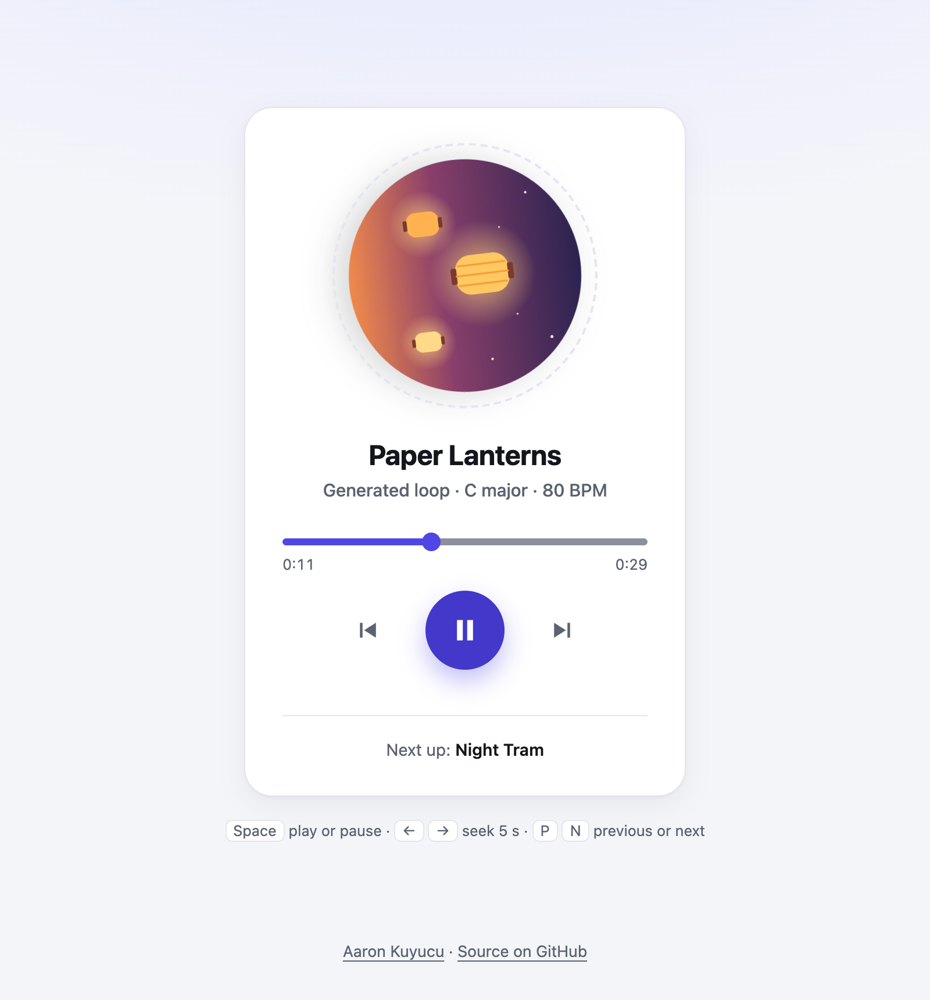

# Music Player

A small music player for a fixed playlist of three short loops: play, pause, next, previous and seeking, built on the HTML `<audio>` element.



Live version: **[aaronkuy.github.io/music-player](https://aaronkuy.github.io/music-player/)**

## Features

- Play and pause, next and previous track
- Seek bar with elapsed and total time
- The next track starts when one ends; after the last track the playlist starts again
- "Previous" restarts the current track once it has played for three seconds
- Title, cover and a "Next up" preview change with each track
- A message appears when a file cannot be loaded or the browser blocks playback
- Buttons have accessible names, and the cover stops rotating when the system asks for reduced motion

### Keyboard

| Key | Action |
| --- | --- |
| <kbd>Space</kbd> | Play or pause |
| <kbd>←</kbd> / <kbd>→</kbd> | Seek 5 seconds back or forward |
| <kbd>P</kbd> / <kbd>N</kbd> | Previous or next track |

## How to run

There is no build step and no runtime dependency. Node.js is only needed for the tests and the audio generator.

```bash
git clone https://github.com/aaronkuy/music-player.git
cd music-player
open index.html        # macOS; on Linux use xdg-open, on Windows start
```

## How it works

| File | Purpose |
| --- | --- |
| `index.html` | Markup; the icons are inline SVG |
| `playlist.js` | The playlist and the calculations (index wrap-around, time format, seek limits) |
| `index.js` | Connects the page to the `<audio>` element |
| `style.css` | Styles |
| `tools/make-loops.mjs` | Generates the audio files |
| `tests/playlist.test.js` | Tests for `playlist.js` |

The play button and the rotating cover are drawn from the events of the `<audio>` element (`play`, `pause`, `ended`, `emptied`, `error`), not from the clicks. That way the display stays right when playback changes without a click, for example when a track ends or a media key pauses it.

## Audio

The three loops are not recordings. `tools/make-loops.mjs` computes them from sine waves and seeded noise, so every run produces the same audio:

```bash
node tools/make-loops.mjs            # WAV files in tools/out/
node tools/make-loops.mjs --encode   # also encodes assets/audio/*.m4a (needs ffmpeg)
```

To use other music, put the files into `assets/audio/` and edit the `tracks` array in `playlist.js`.

## Tests

```bash
node --test "tests/*.test.js"
```

The tests cover the calculations in `playlist.js` and check that every file named in the playlist exists. They need Node.js 22 or newer and run on every pull request. The behaviour in the browser is not covered by automated tests.

## Known limitations

- Checked in Chrome only. Safari and Firefox are untested.
- Seeking needs a server that answers range requests. GitHub Pages does; some simple local servers do not, and the position then jumps back to the start. Opening `index.html` from disk works.
- No volume control and no Media Session integration (the lock screen and the system media controls show no track title).
- The playlist is fixed in `playlist.js`.

## Credits

The first version of this player closely follows two tutorial projects:

- Markup and base styles: [TylerPottsDev/music-app](https://github.com/TylerPottsDev/music-app). The card layout and the class names `app-wrapper`, `player`, `player-controls`, `skip-btn` and `next-up` come from there.
- Player logic: the music player in [bradtraversy/vanillawebprojects](https://github.com/bradtraversy/vanillawebprojects/tree/master/music-player), with its load, play, pause, previous and next structure.

Changed since then: the state handling described above, the seek bar, keyboard control, error messages, the accessibility work, inline SVG icons instead of an icon font, generated audio and covers, and the tests.

Earlier versions of this repository contained three tracks released by NoCopyrightSounds, a photo and the NCS logo as cover. They were removed from the current version. They are still part of the Git history.

## License

[MIT](LICENSE) applies to the code. The audio loops in `assets/audio/` are generated by `tools/make-loops.mjs` and released under [CC0 1.0](assets/audio/LICENSE.txt).
