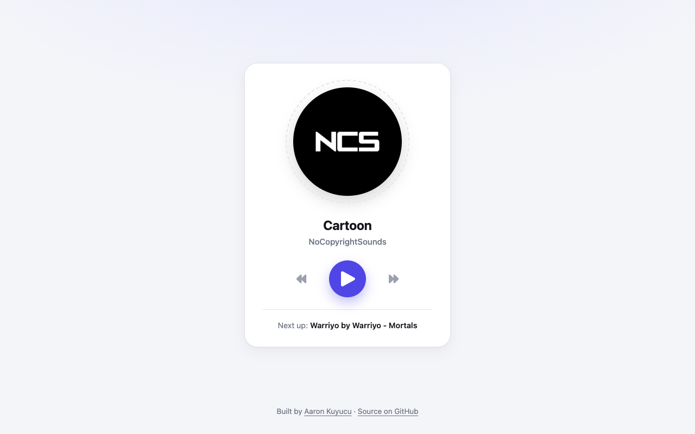

# Music Player

A small music player that plays a fixed playlist with play, pause, next and previous.



## Features

- Play/pause toggle
- Next and previous track
- Title, artist, cover and a "Next up" preview update with each track
- Responsive card layout

## Tech

- HTML `<audio>`, CSS, vanilla JavaScript
- Font Awesome icons (bundled locally in `icons/`, marked as vendored for GitHub's language stats)

## How to run

Open the live version: **[aaronkuy.github.io/music-player](https://aaronkuy.github.io/music-player/)**

Or run it locally. There is no build step and no dependency:

```bash
git clone https://github.com/aaronkuy/music-player.git
cd music-player
open index.html        # macOS; on Linux use xdg-open, on Windows start
```

## What I learned

- Controlling an `<audio>` element from JavaScript
- Keeping UI and playback state in sync
- Cycling through an array with wrap-around indices

## What I'd do next

- Progress bar with seeking and a volume control
- Play the next track automatically when one ends
- Load the playlist from a JSON file

## Notes

Music: the three tracks were released by NoCopyrightSounds (NCS); all rights remain with the artists. To use your own music, put the `.mp3` files next to `index.html` and edit the `songs` array in `index.js`.

## License

See [LICENSE](LICENSE).
